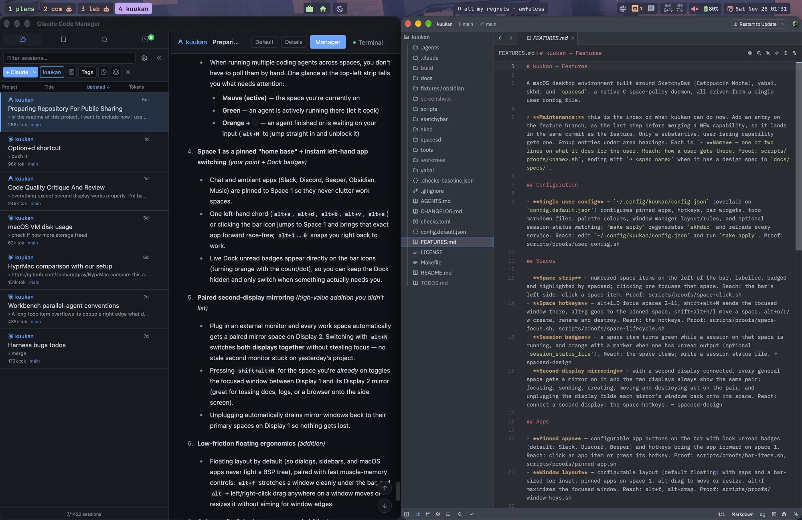
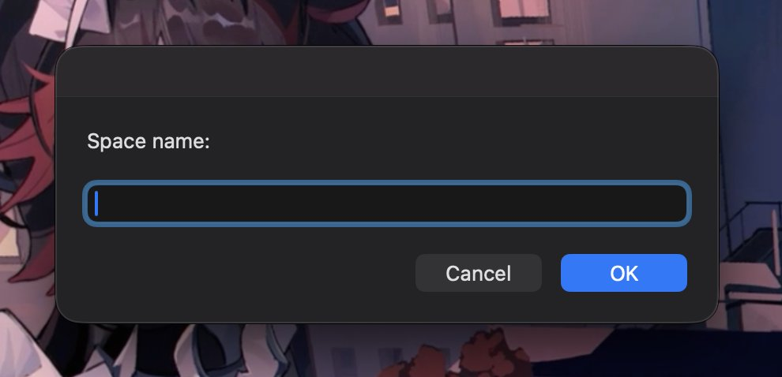
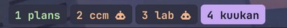
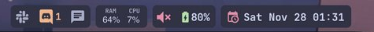
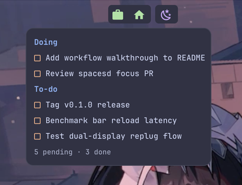
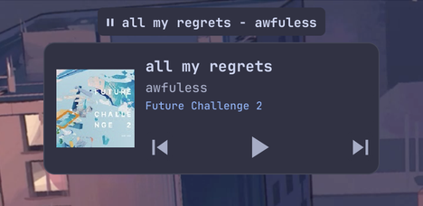
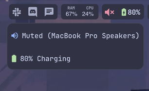
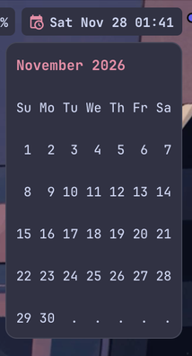

# kuukan

A macOS desktop environment built for parallel, keyboard-driven work — combining **SketchyBar**, **yabai**, **skhd**, and **`spacesd`**, a native C99 space-policy daemon, configured from a single JSON file (`~/.config/kuukan/config.json`).



*Space 4 (`kuukan`) active with Zed and a session manager; Space 1 (`plans`) green with an agent running; Spaces 2 and 3 (`ccm`, `lab`) orange with `󰚩` waiting for input; Discord showing an unread badge on the right.*

---

## How It Works Day-to-Day

Most macOS window-manager setups focus on rigid window tiling. `kuukan` is built around a different primitive: **named, lightweight Mission Control spaces** that isolate parallel workstreams, surface live agent and app status in the bar, and keep a second display locked in sync.

### 1. One space per unit of work

Each project or active thread gets its own named space (`1 plans`, `2 ccm`, `3 lab`, `4 kuukan`). A typical space holds one editor (e.g. Zed), one browser window scoped to that task, and one terminal or coding-agent window. Instead of hunting through a pile of browser windows or Alt-Tabbing across unrelated projects, pressing `alt+1`…`0` jumps directly to the space you want with sub-10 ms highlight feedback and zero Mission Control animation lag.

### 2. Spin up and tear down ad-hoc spaces

Need to review a PR, debug a one-off issue, or try a quick spike without disturbing your active layout?

<p></p>

- Press **`alt+n`**, type a name, and start in a fresh space immediately.
- Reorder spaces as priorities shift with **`shift+alt+h`** / **`l`** — space names are stored by UUID, so they travel with the space and never drift when spaces are created or removed. Rename anytime with **`alt+r`**.
- When the task is finished, close the windows and press **`alt+w`** to destroy the space cleanly.

### 3. Ambient agent and session radar



When running multiple coding agents across parallel spaces, the top-left strip acts as a live status board so you never have to cycle through spaces to check progress:

- **Green** (`1 plans`) — an agent is actively running in that space; let it keep working.
- **Orange + `󰚩`** (`2 ccm`, `3 lab`) — an agent finished or is waiting on your input; hit `alt+2` or `alt+3` to jump straight in and unblock it.
- **Mauve** (`4 kuukan`) — the space you are currently on (turns green fill if an agent is actively running on it).

`spacesd` watches `session_status_file` via `kqueue` (zero polling) and maps each session's window ID to its space in under 50 ms — usable with [claude-code-manager](https://github.com/zillydev/claude-code-manager) or any script that writes the tiny JSON status format below.

### 4. Space 1 as a pinned "home base" for ambient apps



Communication and utility apps (Slack, Discord, Beeper, Obsidian, YouTube Music) are automatically pinned to Space 1 so they never clutter work spaces:

- **Instant left-hand switching** — press `alt+s` (Slack), `alt+d` (Discord), `alt+b` (Beeper), `alt+v` (Obsidian), or `alt+a` (Music) — or click its bar icon — to jump to Space 1 and raise that exact app race-free. Press `alt+1`…`0` to snap straight back to your task.
- **Live Dock unread badges** — `spacesd` reads Dock badges via Accessibility and lights up the bar icon orange with the count (or dot) so you can keep the macOS Dock hidden and only switch when something actually needs attention.

### 5. Paired second-display mirroring

macOS's *Displays have separate Spaces* usually leaves a second monitor stuck on whatever old project you were working on earlier. With an external monitor connected, `spacesd` automatically pairs every general space on Display 1 with a matching mirror space on Display 2:

```text
  Display 1 (primary)         Display 2 (mirror)
  ┌───────────────────┐       ┌───────────────────┐
  │ 1 plans           │ ◄───► │ 1* plans          │   alt+1..0 switches BOTH displays together
  │ 2 ccm             │ ◄───► │ 2* ccm            │   without stealing focus or warping cursor
  │ 3 lab             │ ◄───► │ 3* lab            │
  │ 4 kuukan          │ ◄───► │ 4* kuukan         │   shift+alt+4 on space 4 toggles the focused
  └───────────────────┘       └───────────────────┘   window between Display 1 and Display 2
```

Unplugging the monitor automatically drains every mirror window back onto its primary space on Display 1 so nothing gets orphaned; plugging back in re-pairs cleanly.

### 6. Fast floating window ergonomics

Rather than fighting macOS dialogs and sidebars with a rigid tiling tree, `kuukan` defaults to floating layout with fast muscle-memory controls:

- **`alt+f`** stretches the focused window to full usable height right underneath the bar while keeping its horizontal column and width.
- **`alt` + left-click drag** moves any window from anywhere inside it; **`alt` + right-click drag** (two-finger click-drag on a trackpad) resizes from anywhere without aiming for window edges.
- **`shift+alt+1`…`0`** sends the focused window to another space (or toggles it to the second display if already there).

### 7. Quiet-until-clicked status popups

Everything else stays unobtrusive in the notch-aware bar until you click it: Markdown todo checklists (`Doing` + `To-do`), now-playing media controls, volume + battery + Bluetooth headphone battery (including Sony RFCOMM V2 battery reads), a month calendar, and a one-click light/dark theme toggle.

<table>
  <tr>
    <td align="center" width="50%">
      <br />
      <sub><b>Markdown todos</b> — reads <code>Doing</code> and <code>To-do</code> from Obsidian or any <code>.md</code> file</sub>
    </td>
    <td align="center" width="50%">
      <br />
      <sub><b>Media controls</b> — cover art, track info, and playback controls</sub>
    </td>
  </tr>
  <tr>
    <td align="center" width="50%">
      <br />
      <sub><b>Audio &amp; battery</b> — output device, laptop charge, and Bluetooth headphone battery</sub>
    </td>
    <td align="center" width="50%">
      <br />
      <sub><b>Calendar</b> — current month on click</sub>
    </td>
  </tr>
</table>

---

## Architecture

```text
  ~/.config/kuukan/config.json (overlaid on config.default.json)
        │
        ├──► sketchybarrc     creates bar items & popups, invokes plugins
        ├──► yabairc          window layout, gaps, pinned & floating rules
        ├──► render-skhdrc.sh generates ~/.config/kuukan/skhdrc for skhd
        └──► spacesd (C99)    reads pinned apps, palette & session status path
               ├── SkyLight + NSWorkspace  ◄── space, window & display events
               ├── Mach CLI wire           ──► stock SketchyBar (space.* & app.*)
               ├── Unix socket + SA socket ──► stock yabai & Dock scripting addition
               └── Accessibility           ──► pinned-app focus & Dock badges
```

See [docs/specs/2026-08-30-spacesd-design.md](docs/specs/2026-08-30-spacesd-design.md) for the full `spacesd` architecture and invariants.

## Prerequisites

- **macOS on Apple Silicon** with Command Line Tools (`xcode-select --install`) and SIP disabled for yabai's scripting addition ([yabai wiki](https://github.com/koekeishiya/yabai/wiki/Disabling-System-Integrity-Protection)).
- **Mission Control**: enable *Displays have separate Spaces* and disable *Automatically rearrange Spaces based on most recent use* in System Settings → Desktop & Dock.
- **Core tools** (Homebrew):
  ```sh
  brew install koekeishiya/formulae/yabai
  brew install koekeishiya/formulae/skhd
  brew install FelixKratz/formulae/sketchybar
  brew install jq
  brew install --cask font-jetbrains-mono-nerd-font
  ```
- **Optional**:
  - [`media-control`](https://github.com/ungive/media-control) for the now-playing media widget.
  - A macOS Shortcut named `Toggle Appearance` (one action: *Set Appearance → Toggle*) for the theme toggle widget.
  - A session-status JSON producer at `session_status_file` (`{"sessions": {"id": {"state": "running"|"unread", "window": <cg_wid>}}}`) for space session badges.

## Installation

1. **Clone anywhere:**
   ```sh
   git clone https://github.com/zillydev/kuukan.git
   cd kuukan
   ```

2. **Create a self-signed code-signing certificate for `spacesd`** (keeps the Accessibility grant valid across rebuilds):
   ```sh
   spacesd/scripts/setup-codesign.sh
   ```

3. **Build helpers and `spacesd`:**
   ```sh
   make build
   make -C spacesd bin/spacesd
   ```

4. **Install symlinks, default config, generated `skhdrc`, and LaunchAgent plist:**
   ```sh
   make install
   ```
   This links `~/.config/sketchybar`, `~/.config/yabai`, `~/.config/kuukan/spacesd`, and `~/.config/kuukan/config.default.json`, creates `~/.config/kuukan/config.json` (if not already present), renders `~/.config/kuukan/skhdrc` (linked at `~/.config/skhd/skhdrc`), and renders `~/Library/LaunchAgents/dev.zilly.spacesd.plist` with your checkout's path.

5. **Start the services:**
   ```sh
   launchctl bootstrap "gui/$(id -u)" ~/Library/LaunchAgents/dev.zilly.spacesd.plist
   yabai --start-service
   skhd --start-service
   brew services start sketchybar
   ```

6. **Grant permissions:**
   - **Accessibility** (System Settings → Privacy & Security → Accessibility): allow `yabai`, `skhd`, and `spacesd` (run `~/.config/kuukan/spacesd/bin/spacesd -m axprompt` to trigger the prompt).
   - **Bluetooth**: macOS prompts on first run of `bt_battery` when opening the battery/volume popup.

## Configuration

Edit **`~/.config/kuukan/config.json`** and run:

```sh
make apply
```

`~/.config/kuukan/config.json` is deep-merged on top of [`config.default.json`](config.default.json) (objects merge recursively; arrays replace the default array), so you only need to specify the keys you want to override.

### Example `~/.config/kuukan/config.json`

```json
{
  "bar": {
    "font": "JetBrainsMono Nerd Font",
    "height": 39,
    "notch_width": 200,
    "colors": {
      "mauve": "0xffcba6f7"
    }
  },
  "pinned_apps": [
    { "id": "Slack",   "app": "Slack",   "icon": "󰒱", "bar": true,  "hotkey": "alt - s", "yabai_rule": "^Slack$" },
    { "id": "Discord", "app": "Discord", "icon": "󰙯", "bar": true,  "hotkey": "alt - d", "yabai_rule": "^Discord$" },
    { "id": "Mail",    "app": "Mail",    "icon": "󰇮", "bar": true,  "hotkey": "alt - m", "yabai_rule": "^Mail$" },
    { "id": "Music",   "app": "Music",   "icon": "",  "bar": false, "hotkey": "alt - a", "yabai_rule": "^Music$" }
  ],
  "widgets": {
    "clock": { "enabled": true },
    "battery": { "enabled": true },
    "volume": { "enabled": true },
    "cpu_ram": { "enabled": true },
    "theme": { "enabled": true, "shortcut": "Toggle Appearance" },
    "media": { "enabled": true, "app": "Music" },
    "todos": [
      { "id": "todo.personal", "icon": "󰋜", "file": "~/Notes/Personal/Todos.md" },
      { "id": "todo.work",     "icon": "󰃖", "file": "~/Notes/Work/Todos.md" }
    ],
    "lock_animation": { "enabled": true }
  },
  "hotkeys": {
    "focus_pinned": "alt - g",
    "maximize": "alt - f"
  },
  "session_status_file": null
}
```

### Todo file format

Each entry in `widgets.todos` reads a Markdown checklist with optional `## Doing`, `## To-do`, and `## Completed` headings (`- [ ]` open items, `- [x]` completed items). Set `"todos": []` to disable the todo widget group.

## Default Keybindings

| Shortcut | Action |
| --- | --- |
| `alt + 1` … `0` | Focus general spaces 1–10 (Mission Control spaces 2–11) and sync display 2 mirror |
| `shift + alt + 1` … `0` | Send focused window to space 1–10 (toggle primary ↔ mirror if already there) |
| `alt + g` / `shift + alt + g` | Focus pinned space (space 1) / send focused window to space 1 |
| `alt + s / d / b / a / v` | Bring pinned app forward on space 1 (configurable in `pinned_apps`) |
| `alt + n` / `alt + r` / `alt + w` | Create named space / rename current space / destroy current space |
| `shift + alt + h` / `l` | Move current space (and its mirror) left / right |
| `alt + f` | Maximize focused window vertically below the bar |
| `alt + left-click drag` | Move window under cursor |
| `alt + right-click drag` | Resize window under cursor (two-finger click-drag on trackpad) |
| `ctrl + alt + cmd + r` | Restart yabai |

## Development & Testing

- **`make test`** — runs lint checks (`config.default.json` validation, `skhd/skhdrc` sync check, `bash -n`, `shellcheck`), builds helpers, compiles all `spacesd` sources with `-Wall -Wextra -Werror`, runs `spacesd` C unit tests, and runs `scripts/live_test.sh`.
- **Headless macOS VM tests (`make agent` / `make proofs`)** — optional end-to-end verification in a headless [Tart](https://github.com/cirruslabs/tart) macOS VM running real `yabai` + scripting addition + `spacesd` + `skhd` + `sketchybar` without touching your host desktop. See [docs/agent-vm.md](docs/agent-vm.md).

## License

MIT — see [LICENSE](LICENSE). Vendors [jsmn](https://github.com/zserge/jsmn) (MIT). Built on [yabai](https://github.com/koekeishiya/yabai), [SketchyBar](https://github.com/FelixKratz/SketchyBar), [skhd](https://github.com/koekeishiya/skhd), and [Catppuccin Mocha](https://github.com/catppuccin/catppuccin).
